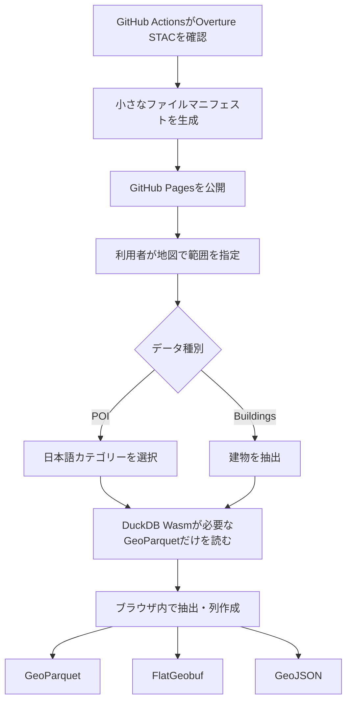

# Overture Maps データ取得

Overture MapsのPOIとBuildingsを、地図またはbboxで範囲指定して取得する日本語Webアプリです。GitHub Pages上で公開し、抽出処理は利用者のブラウザ内で完結します。

## 主な機能

- 地図の表示範囲またはbboxによる範囲指定
- 地図上のドラッグによる矩形範囲指定
- POIとBuildingsの選択
- POIの日本語7分類と、Overture公式の全カテゴリー名からの検索・複数選択
- 対象ファイルの準備、抽出、変換、ファイル生成を示す進捗表示
- `names.primary`からの施設名作成
- POIへの次の列の追加
  - `施設名`
  - `生活機能区分`、`生活機能詳細コード`、`生活機能詳細区分`
  - `食料品アクセス区分コード`、`食料品アクセス区分`、`食料品分類根拠`
  - `食料品分類確度`、`食料品名称判定キー`
  - `調剤サブ施設フラグ`
  - `ドラッグストアチェーン`、`スーパーマーケットチェーン`
  - `Overtureブランド名`
  - Overtureの`taxonomy.primary`、`taxonomy.hierarchy`、`taxonomy.alternates`、`basic_category`
- GeoParquet、FlatGeobuf、GeoJSON出力
- 最新Overtureリリースへの日次追従
- アカウント登録、サーバー保存、有料APIなし

## データの流れ



## 無料で運用できる理由

GitHub PagesはHTML、CSS、JavaScriptとマニフェストだけを配信します。Overtureの元データや利用者が作成したファイルをGitHubへ保存しません。DuckDB WasmがOverture公式の公開GeoParquetを必要な範囲だけ読み、完成ファイルを利用者のブラウザから直接保存します。

## 制限

- POIは概算15,000 km²以下、Buildingsは概算3,000 km²以下に制限しています。
- FlatGeobufとGeoJSONはブラウザのメモリを考慮し、20万件以下に制限しています。
- それを超えるデータにはGeoParquetを使用してください。
- 公共交通など一部のOvertureカテゴリーは、日本国内の全施設を網羅するものではありません。
- Overtureのカテゴリーやスキーマ変更により、分類設定の更新が必要になる場合があります。

## 食料品アクセス分類

農林水産省の食料品アクセスマップの業態区分を踏まえ、1「生鮮食料品専門小売店」、2「百貨店・総合スーパー・食料品スーパー」、3「ドラッグストア」、4「コンビニエンスストア」、5「農産物直売所・ファーマーズマーケット」、9「その他の食料品店（生鮮取扱未確認）」、0「判定保留・除外」を付与します。

分類はOverture schema v2.0.0のtaxonomyを優先します。検索時は`taxonomy.alternates`も参照しますが、食料品アクセス区分の直接判定には主階層の`taxonomy.hierarchy`を使います。実データでは通常の調剤薬局にも代替カテゴリー`drugstore`が付くため、代替カテゴリーだけでドラッグストアに分類しません。`grocery_store`に統合されたスーパーと、`pharmacy`に入ったドラッグストアは名称情報で補います。照合対象は施設名、Overtureのブランド名、共通名とし、URLの偶然一致は業態の根拠にしません。全角・半角、空白、中点などの表記揺れを正規化しますが、日本語の長音符「ー」は別の単語との誤一致を避けるため保持します。スーパー辞書は全国チェーンに加えて北海道から沖縄までの地域屋号を収録し、辞書にない店舗も「スーパーマーケット」「食品館」「フードマーケット」などの業態語から推定します。`grocery_store`の施設名に明示された「スーパー」は中程度の根拠とし、明白な異業態の名称は除外します。青果・鮮魚・食肉を示す名称は、生鮮専門店の補助根拠として利用します。調剤窓口などのサブPOIは重複を避けて食料品分類から除外します。

`grocery_store`であっても、名称からセルフサービス方式の食料品スーパーまたは生鮮3品の取扱いを確認できない店舗は、根拠なく区分1または2へ割り当てません。区分9「その他の食料品店（生鮮取扱未確認）」として残し、`食料品分類確度`を「低」とします。これにより、食料品POIを判定保留から救済しながら、農林水産省のアクセスマップ対象店舗との同一視を避けます。

名称辞書による分類は推定です。開店・統合・屋号変更や表記揺れがあるため、分析時は`食料品分類根拠`と原カテゴリーも確認してください。

### 全国サンプルによる確認（2026-10-19）

Overture `2026-09-23.1` のPlacesを、北海道から沖縄まで都市中心部と地方都市・農村を含む16地区の開発用矩形、別の9地区の検証用矩形で抽出しました。面積や人口による無作為抽出ではありません。開発側11,547件、検証側3,044件の関連POIから、主階層または代替カテゴリーが`grocery_store`の3,659件について名称判定を旧版と比較しました。区分2の候補は開発地区で822→885件、別地区で200→212件となりました。一方、普通の`pharmacy`にも代替`drugstore`が付く現象は全25地区で1,569件確認され、これを直接判定から除外しました。これらは自動分類の変化件数であり、真の適合率・再現率ではありません。とくに区分9には専門店、卸・事務所、誤登録された飲食店、情報不足のスーパーが混在するため、研究利用時は店舗ごとの営業実態を別資料で検証してください。

抽出矩形とSQL監査用スクリプトは`scripts/sample_food_places.py`、`scripts/audit_food_places.mjs`、`scripts/compare_food_audit.mjs`にあります。抽出にはPython版DuckDB、SQLの統合確認には`scripts/verify_food_sql.py`を利用できます。監査用CSVには施設名と位置情報が含まれるためリポジトリへは保存していません。屋号の確認には、例えば[キクコーストア](https://kikuko-store.com/)、[ワイズマート](https://www.ysmart.co.jp/store/)、[フードプラザにしだ](https://www.foodplaza-nishida.com/)、[フレッシュプラザ ユニオン](https://union-okinawa.com/storelist/)などの事業者の店舗情報を参照しました。

食料品以外の生活機能は、現行taxonomyの主階層と代替分類を使って病院、診療所、歯科、調剤薬局、高齢者施設、地域支援、ATM、銀行、郵便局、行政機関、鉄道、バス、タクシー、公園、運動施設、図書館、博物館、文化施設、日常生活サービスなどに分けます。QGISでは`生活機能詳細区分`をカテゴリ値に指定すると機能別に色分けできます。

画面の全カテゴリー名は、旧カテゴリーとの対応表ではなく、Overture公式のCanonical Taxonomy JSONから生成します。データリリースがパッチ版の場合も、その月のCanonical Taxonomyと整合する版を取得し、分類数と階層構造を検証してから公開します。

分類設計の主な参照先:

- [農林水産省 食料品アクセス（買い物弱者・買い物難民等）問題ポータルサイト](https://www.maff.go.jp/j/shokusan/eat/access_genjo.html)
- [e-Stat 日本標準産業分類 5811 食料品スーパーマーケット](https://www.e-stat.go.jp/classifications/terms/10/04/5811)
- [Overture Maps Places Taxonomy](https://docs.overturemaps.org/guides/places/taxonomy/)
- [全国スーパーマーケット協会 正会員一覧](https://www.super.or.jp/?page_id=71)
- [日本スーパーマーケット協会 通常会員](https://www.jsa-net.gr.jp/kaiin/ithiran.html)
- [CGCグループ 全国のメンバー企業](https://www.cgcjapan.co.jp/cgcgroups/group/)
- [日本チェーンドラッグストア協会 会員リスト](https://jacds.gr.jp/member-hp/)
- [ツルハホールディングス グループ企業一覧](https://www.tsuruha-hd.co.jp/company/list/)

## ローカル開発

Node.js 22とPython 3.12を使用します。

```bash
npm install
python scripts/update_manifest.py
npm run dev
```

テストと本番ビルドは次のとおりです。

```bash
npm test
npm run build
```

## GitHub Pages

`.github/workflows/deploy-pages.yml`が次の場合にビルドと公開を行います。

- `main`へのpush
- 手動実行
- 日次スケジュール

リポジトリのSettings → Pages → Sourceを`GitHub Actions`に設定してください。

## データとライセンス

- Overture Maps data: Overture Maps Foundation
- OpenStreetMap: © OpenStreetMap contributors
- アプリケーションコード: MIT License

Overtureのテーマ別ライセンスと帰属表示は、[公式のAttribution and Licensing](https://docs.overturemaps.org/attribution/)を確認してください。

## プライバシー

このアプリは利用者登録、アクセス範囲の保存、取得ファイルのアップロードを行いません。抽出条件と完成データは利用者のブラウザ内だけで処理されます。
